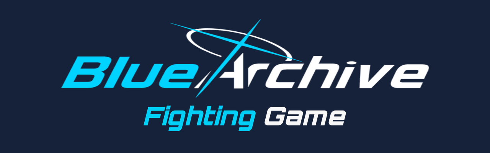
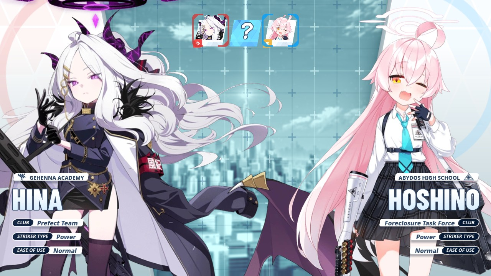
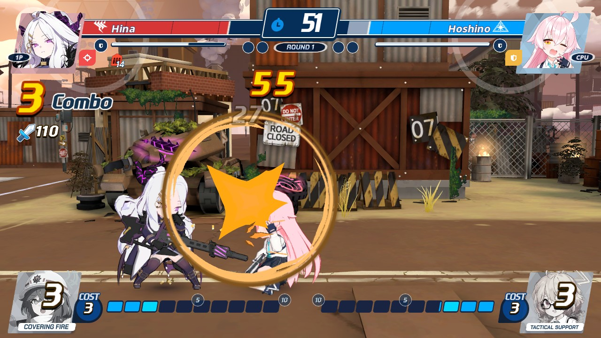
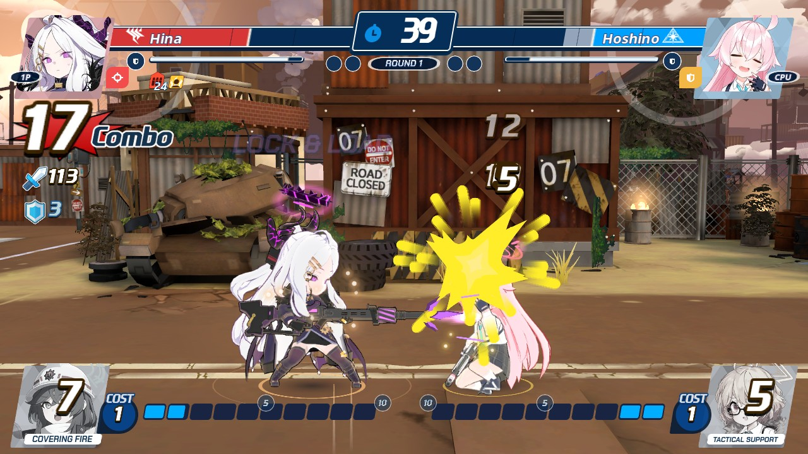
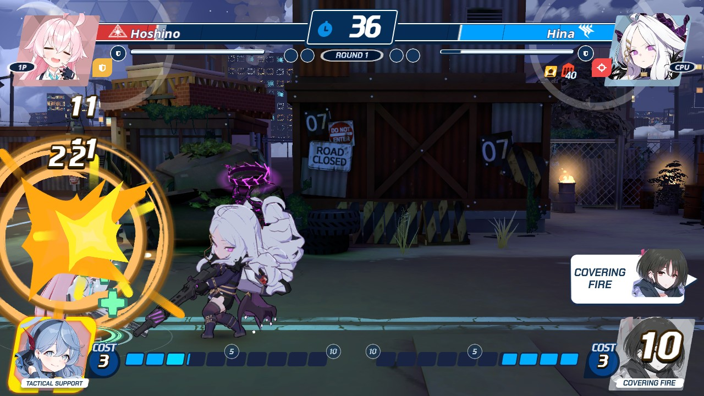

<table>
<tr>
<td></td>
<td></td>
</tr>
<tr>
<td></td>
<td></td>
</tr>
<tr>
</tr>
</table>

A fan-made one-on-one fighting game set in the world of Blue Archive, played on a 2D side-view lane. It is built in Godot 4.7. Builds for macOS and Windows are attached to each release. This is an unofficial fan project. Blue Archive and its art belong to Nexon Games and Yostar. Credits are in `CREDITS.md`.

Direct Inspiration goes to [@ThatKirbo](https://x.com/ThatKirbo) On Twitter. They inspired me to start this project.

## The idea

One or two players pick a student and a map, then fight a best-of-three. Students play differently from each other because their moves come from their weapon and role in the game, and their personality shapes the style.

Fighters are the game's own chibi 3D models standing on the 2D lane, and each map is a Blue Archive battle map rebuilt as a 3D scene behind it. The menus follow the look of the original game.

A fighter counts as finished when it has a complete 3D model, its animations and a checked move set. A map counts as finished when it is a complete 3D scene. This repository holds only finished content. Fighters and maps still in progress are developed elsewhere and are added once they are done.

## What works today

- The whole flow: main menu, controller assign, character select with an assist pick, stage select, a VS screen, the fight and a result screen.
- Versus 2P, Versus CPU, Single Play (an arcade ladder against the CPU), Training, Extras (gallery, jukebox and records) and Options. Story and Network show "Coming soon".
- Two finished fighters, each with their own moves and a 3D model.
- One finished 3D map, with day and night lighting and animated effects such as barrel fires and smoke.
- Best of three rounds with a 60 second timer, a health bar and a guard meter. Light and heavy attacks chain into skills. An EX meter pays for supers and for an ult with its own cut-in. An assist can be called on a cooldown. Dashes, high, low and air blocks, just guard, guard crush and throws are all in. Each round opens with an intro, and a knockout ends in slow motion.
- A CPU opponent with four skill levels.
- A HUD, effects, sound effects and music in the style of the original game. The music comes from the game's soundtrack.
- Two keyboard layouts and gamepads.

## What is still to do

### Online play

- [ ] Rollback netcode for versus, so matches stay smooth on real connections
- [ ] Matchmaking and invites through Discord first, with Steam added later behind the same interface
- [ ] Player profiles from the player's account
- [ ] A leaderboard hosted on our own server, rated with Glicko-2 and shown as ranks
- [ ] Ranked seasons
- [ ] Server-side anticheat: the server replays ranked matches from both players' recorded inputs and rejects any result that does not match
- [ ] A walkable lobby shaped like an arcade hall, where you sit at a cabinet to challenge or queue
- [ ] Spectating, by standing behind a cabinet

### More modes

- [ ] Story mode, as a short arc for each fighter
- [ ] Survival and time attack
- [ ] Team battle, three against three, with swaps between fighters

### Practice and learning

- [ ] Combo trials for each fighter
- [ ] A move list with frame data for each fighter
- [ ] Saved replays
- [ ] A tutorial, later in development

### More content

- [ ] More fighters, each with a finished 3D model, animations and a checked move set
- [ ] More 3D maps
- [ ] Stage select with a live 3D preview, rendered thumbnails, paging by school and a day and night toggle
- [ ] Alternate costumes
- [ ] Progression and rewards
- [ ] Japanese and English text
- [ ] New fighters and maps come in the order we choose after community polls

### Settings

- [ ] Accessibility settings
- [ ] More video settings
- [ ] More audio settings
- [ ] Remappable controls

---

Made with love by konekurosawa

Leave a buck if you want. It incentivizes me to work on this. 

